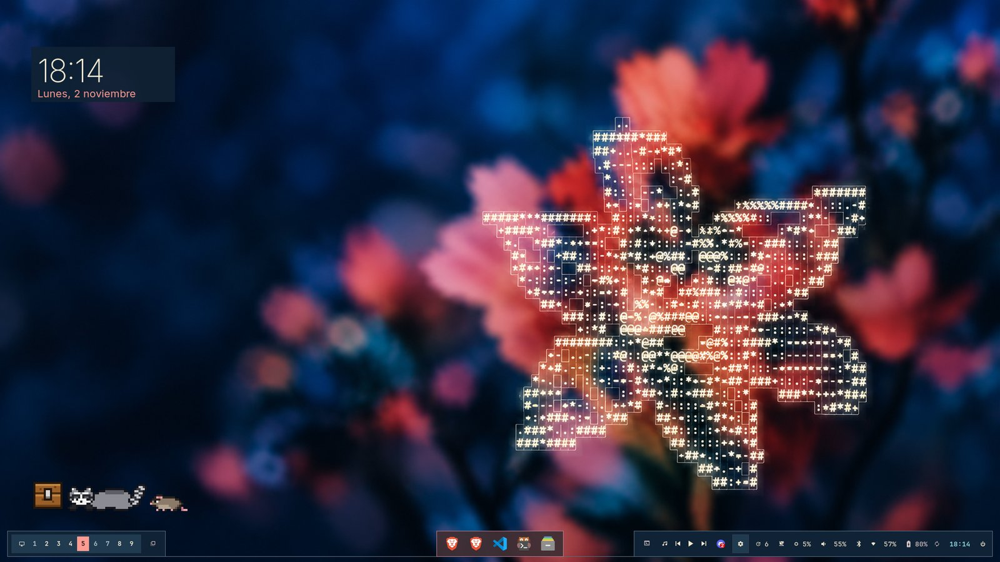
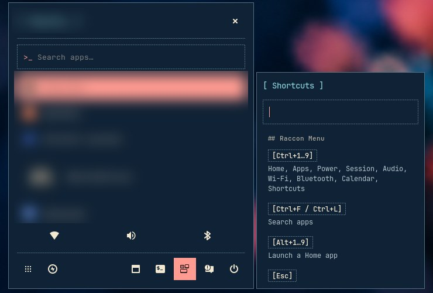
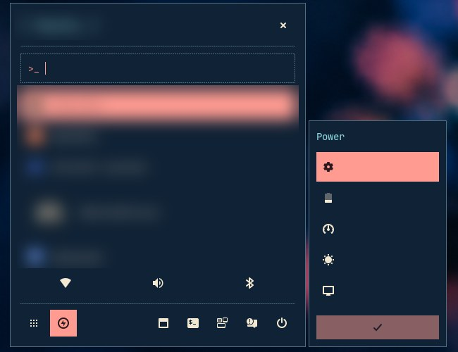
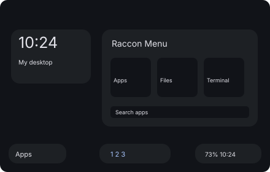
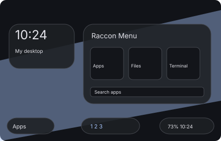
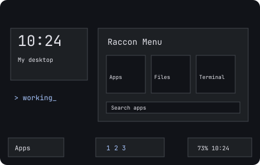
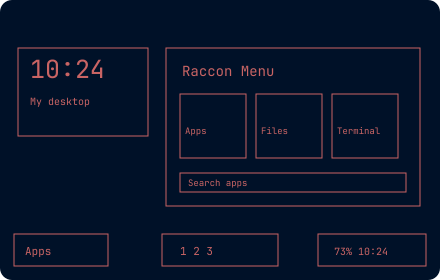
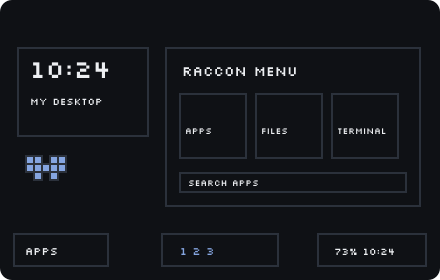
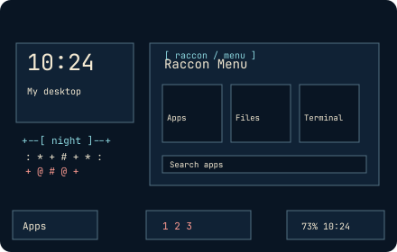
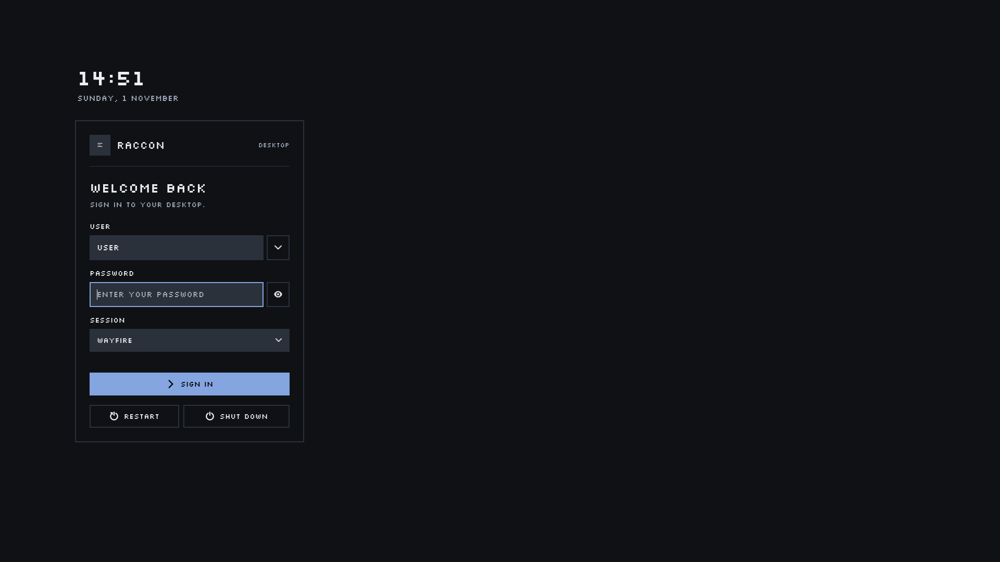

# Raccon Dots

```text
⠀⠀⠀⠀⢀⣠⠤⠒⠒⠒⠒⠒⠒⠤⠤⣀⣀⣀⣀⣀⡤⠤⠤⠄⠤⡤⣲⣽⡇⠀
⠀⠀⡠⠖⠉⠀⠀⠀⠀⠀⠀⠀⠀⠀⠀⠀⠉⠁⠉⠁⠀⠀⠚⠛⠿⠰⠟⣿⡇⠀
⠀⡴⠁⠀⠀⠀⠀⠀⠀⠀⠀⠀⠀⠀⠀⠀⠀⠀⠀⠀⠀⠀⡏⠀⠀⠀⠀⠙⡄⠀
⢰⠁⠀⠀⠀⠀⠀⠀⠀⠀⠀⠀⠀⠀⠀⠀⠀⠀⠀⠀⠀⠀⣇⠀⢸⣿⣷⣦⡇⠀
⣼⠀⠀⠀⠀⠀⠀⠀⠀⠀⠀⢀⠀⠀⠀⠀⠀⠀⠀⠀⠀⢀⡿⠷⣄⠉⠛⠈⠀⠀
⣇⠀⠀⠀⠀⣧⠀⠀⠀⠀⠀⠈⢦⠀⠀⠀⠀⠀⠀⠀⠀⣼⣆⠀⠈⢂⠀⣀⣡⠀
⠹⣴⣿⣶⣶⣿⣆⠀⠀⠀⠀⠀⠈⣷⡀⠀⠀⠀⠀⠀⠰⠿⠿⠦⠤⠶⣷⣿⣧⣄
⠀⢻⣩⣶⣿⣾⣏⠢⠀⠀⠀⠀⠀⢻⠈⠑⢄⠀⠀⢀⠃⠀⠀⠀⠀⠀⠀⠀⠀⠀
⠀⠈⠿⢋⣥⣶⣿⣆⠑⡀⠀⠀⠀⡞⠀⠀⠈⢶⣀⠀⠀⠀⠀⠀⠀⠀⠀⠀⠀⠀
⠀⠀⠈⢼⡿⠋⢀⣠⣵⡘⢦⣤⣬⣤⣴⣤⣄⠘⠿⠶⠄⠀⠀⠀⠀⠀⠀⠀⠀⠀
⠀⠀⠀⠀⠁⢴⣿⡟⠉⢑⡌⠉⠉⠉⠛⠳⠄⠀⠀⠀⠀⠀⠀⠀⠀⠀⠀⠀⠀⠀
⠀⠀⠀⠀⠀⠀⠙⢄⣾⡿⠃⠀⠀⠀⠀⠀⠀⠀⠀⠀⠀⠀⠀⠀⠀⠀⠀⠀⠀⠀
```

Your personal desktop, packed for the next machine. Version **0.3.0**, defined in [`.rdot`](.rdot).

## Gallery



Raccon Menu opens from the bar or with <kbd>Super</kbd>: search apps, switch power
modes, control audio, Wi-Fi and Bluetooth, and look up every shortcut.

| Shortcuts | Power modes |
| :---: | :---: |
|  |  |

Six desktop styles change the bar, Raccon Menu, window borders and app themes
together. Colors follow your own wallpaper (none is bundled); Night keeps a
fixed navy, ivory and coral palette.

| Default | Transparent | Classic |
| :---: | :---: | :---: |
|  |  |  |
| **Mono** | **Retro** | **Night** |
|  |  |  |

<table>
<tr>
<td width="60%"></td>
<td width="40%"></td>
</tr>
<tr>
<td align="center">Login screen for SDDM (<code>extras/install-sddm.sh</code>)</td>
<td align="center">Boot splash that types code (<code>--setup plymouth</code>)</td>
</tr>
</table>

## Install

Needs Linux, Python 3.11+ and Wayfire 0.11. Automatic package installation needs Arch or CachyOS.

```sh
git clone https://github.com/racconrad/dotfiles.git ~/projects/raccon-dots
cd ~/projects/raccon-dots
./install.sh                                         # interactive installer
./install.sh --profile profiles/raccoon-desktop.json # full desktop
```

The installer previews every change, backs up the files it replaces and lets you restore them with `h`.

## Docs

- [Install](docs/install.md): requirements, profiles, installer keys, CLI, recovery
- [Desktop](docs/desktop.md): styles, Raccon Menu, power modes, tiling, Kitty panel, Zsh prompt
- [tinyWidgets](docs/widgets.md): widget layouts, themes and install modes
- [Maintenance](docs/maintenance.md): `rdot`, AI skills, what is never shipped, tests
